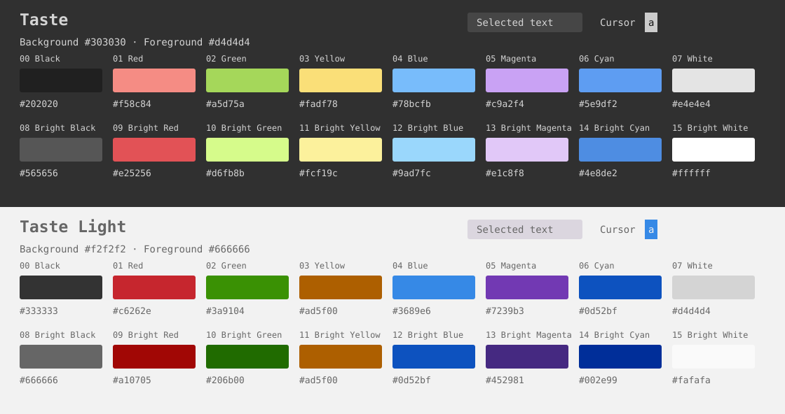

# rex-taste

Light and dark [Taste](https://github.com/jordwalke/vim-taste) color themes for
[Rex](https://www.superlogical.com/rex), based on the elementary OS color palette.



## Install

Clone the repository, then import both themes with Rex running:

```sh
git clone https://github.com/anmonteiro/rex-taste.git
cd rex-taste
rex do client.theme.import path="$PWD/themes/Taste Light.ghostty"
rex do client.theme.import path="$PWD/themes/Taste.ghostty"
```

You can also use **Settings > Themes > Import Theme** to select each file.
Rex stores a copy and selects the imported theme for its light or dark mode.
Under **Settings > Themes**, use **Taste Light** for Light Mode and **Taste** for
Dark Mode. Choose **Auto**, **Light**, or **Dark** under
**Settings > Interface > Appearance > Color scheme**. Auto follows macOS.

To switch explicitly from the command line:

```sh
rex do client.appearance.switch_mode mode=light
rex do client.appearance.switch_mode mode=dark
```

If several Rex app clients are connected, use `rex client ls` and add
`-C CLIENT_ID` before `do` to target the intended one.

To update, run `git pull --ff-only` and repeat the import commands. Rex does not
watch these files; reloading `init.lua` does not update an imported theme.

## Colors

| Role | Taste | Taste Light |
| --- | --- | --- |
| Background | `#303030` | `#f2f2f2` |
| Foreground | `#d4d4d4` | `#666666` |
| Selection background | `#464646` | `#dbd6df` |
| Selection foreground | `#d4d4d4` | `#666666` |
| Cursor | `#cccccc` | `#3689e6` |
| Cursor text | `#111111` | `#f2f2f2` |

**Taste** preserves vim-taste's
[Kitty terminal palette](https://github.com/jordwalke/vim-taste/blob/3d2990876be923856b539d509a8d83d2ca447760/terminals/kitty.conf),
including its ANSI ordering and blue shades for cyan. Its cursor colors match
Kitty's defaults. The upstream iTerm export uses different colors.

**Taste Light** derives its background, foreground, selection background, and
cursor from the actual Vim highlights at `g:taste_light_brightness = 3` in
[colors/taste.vim](https://github.com/jordwalke/vim-taste/blob/3d2990876be923856b539d509a8d83d2ca447760/colors/taste.vim).
Selection text uses the normal foreground. Red, green, blue, magenta, and cyan
use the light syntax hues. The remaining ANSI choices adapt that palette for
terminal use:

- Yellow uses the darkest banana shade (`#ad5f00`), since Vim's pale search
  backgrounds lose contrast when used as text on a light background.
- Bright accents use deeper shades from the same upstream color bank. Yellow
  repeats its darkest shade.
- Black and white retain conventional ANSI roles using the upstream black and
  silver shades. Default text uses the separate foreground color.

The light theme is a terminal adaptation; it does not reproduce upstream's
embedded Vim terminal palette, which uses pale search colors and reverses the
black and white roles in light mode.

Both themes preserve the standard xterm colors 16–255 by disabling
`palette-generate` and `palette-harmonious` in the Ghostty theme files.

## Rendering

For the original sRGB values, turn off **Force theme palette for text**,
**Improve text contrast**, and **Use Display P3 color space** under
**Settings > Terminal > Colors**. Keep **Use extended theme palette** off for
both light and dark themes. These controls are described in
[Rex's settings reference](https://www.superlogical.com/rex/docs/reference/mac-settings).

Programs that set their own colors, such as Vim or Neovim with `termguicolors`,
still use their own color schemes. To match a light Rex window in vim-taste:

```vim
set background=light
colorscheme taste
```

Use `set background=dark` for the dark variant. A terminal theme does not change
an editor's configured background mode.

## Nix

`nix develop` provides Git, Python, and nixfmt. `nix build` installs both theme
files under `result/share/rex/themes/`; import them using their absolute paths
as above.

## Credits

Based on [jordwalke/vim-taste](https://github.com/jordwalke/vim-taste) by
Jordan Walke, with colors originating in the
[elementary OS palette](https://elementary.io/brand).

Released under the [MIT license](LICENSE), retaining the upstream notice.
